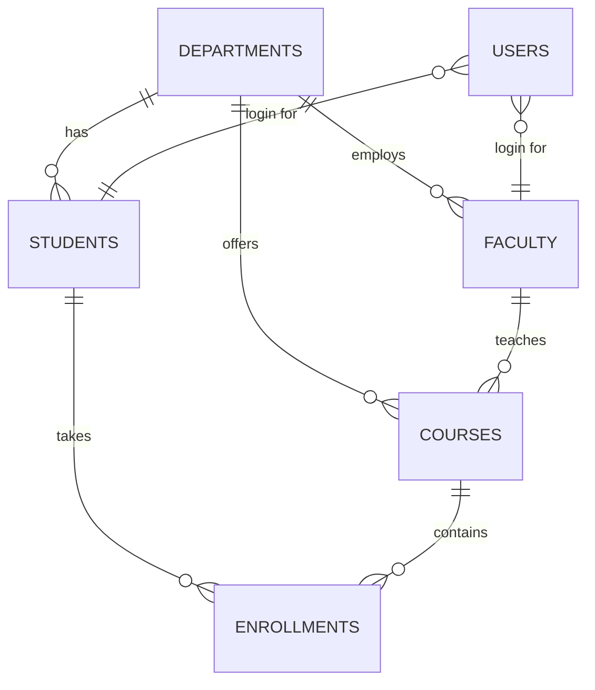

<div align="center">

# 🎓 University Management System

**A student, course and faculty management system with role-based access and reporting.**


</div>

---

## 📖 About

University Management System is a database-driven application that manages the core workflows of a university: students, faculty, departments, courses, enrollments and grades. Three user roles (**admin**, **faculty**, **student**) each get their own permissions and menu, and admins get built-in analytics and CSV reports.

The project focuses on **solid database design**: constraints, triggers, views and indexes enforce the business rules, and a permission-checked service layer sits on top.

## ✨ Features

| Area | What you get |
|---|---|
| **Management** | Full CRUD for students, faculty, courses and departments with validation |
| **Access control** | Role-based permissions enforced in the service layer via a `@require()` decorator |
| **Enrollment** | Capacity enforced by a DB trigger, duplicate prevention, drop rules |
| **Grading** | Marks → letter grade → grade points; credit-weighted GPA via SQL view |
| **Reporting** | Top students, at-risk students, department summary, course stats, grade distribution, faculty workload, **CSV export** |
| **Security** | PBKDF2-SHA256 salted hashing, parameterized queries, constant-time compare |
| **Auditing** | Every write action recorded in an audit log |
| **Quality** | 14 unit tests, GitHub Actions CI, seeded demo data |

## 🚀 Getting Started

### Prerequisites
- Python **3.8 or newer** (check with `python --version`)
- No other installs needed (uses only the standard library)

### Installation & run

```bash
# 1. Clone
git clone https://github.com/WasiTurk/university-management-system.git
cd university-management-system

# 2. Create the database with demo data
python main.py --init

# 3. Launch the app
python main.py
```

> On some systems use `python3` or `py` instead of `python`.

### Run the tests
```bash
python -m unittest discover -v
```

### Demo logins

| Role | Username | Password |
|---|---|---|
| Admin | `admin` | `admin123` |
| Faculty | `cs.prof1` | `faculty123` |
| Student | `26cs-001` | `student123` |

Other students log in with their lowercase roll number (see *List students* as admin). Other faculty follow the pattern `ee.prof1`, `mth.prof2`, etc.

> ⚠️ These are demo credentials for local use only. Change them before any real deployment.

## 🖥️ Sample Output

```text
ROLL_NO    NAME         DEPT  CREDITS_EARNED  GPA 
--------------------------------------------------
23CS-023   Iqra Khan    CS    3               4.0 
24MTH-022  Noor Malik   MTH   9               3.67
26CS-001   Fatima Butt  CS    11              3.53

CODE  NAME                     STUDENTS  FACULTY  COURSES  AVG_GPA
------------------------------------------------------------------
BBA   Business Administration  17        2        2        2.31   
CS    Computer Science         12        2        4        2.65   
EE    Electrical Engineering   10        2        2        2.31   
MTH   Mathematics              21        2        2        2.39   
```

## 🔐 Roles & Permissions

| Capability | Admin | Faculty | Student |
|---|:-:|:-:|:-:|
| Manage students / faculty / courses | ✅ | ❌ | ❌ |
| View all students | ✅ | ❌ | ❌ |
| Enroll any student | ✅ | ❌ | ❌ |
| Self-enroll / drop courses | ❌ | ❌ | ✅ |
| View roster & grade **own** courses | ❌ | ✅ | ❌ |
| View own profile, GPA, transcript | ❌ | ❌ | ✅ |
| Reports & audit log | ✅ | ❌ | ❌ |

## 🗄️ Database Design



See [`schema.sql`](schema.sql). Highlights:
- `CHECK` constraints on marks (0-100), credits, capacity, roles and designations
- `UNIQUE (student_id, course_id, semester)` prevents duplicate enrollment
- Trigger `trg_enroll_capacity` blocks enrollment into full courses
- Triggers remove a user's login when their student/faculty record is deleted
- Views `v_student_gpa` and `v_course_stats` power the reports
- Indexes on foreign keys used in joins

### Grade scale

| Marks | ≥85 | ≥80 | ≥75 | ≥70 | ≥65 | ≥60 | ≥55 | ≥50 | <50 |
|---|---|---|---|---|---|---|---|---|---|
| Grade | A (4.0) | A- (3.7) | B+ (3.3) | B (3.0) | B- (2.7) | C+ (2.3) | C (2.0) | D (1.0) | F (0.0) |

## 📁 Project Structure

```text
university-management-system/
├── main.py              # entry point (--init seeds the DB)
├── schema.sql           # tables, triggers, views, indexes
├── ums/
│   ├── db.py            # connection & schema init
│   ├── auth.py          # hashing, login, RBAC permissions
│   ├── services.py      # business logic (permission-checked)
│   ├── reports.py       # analytics queries + CSV export
│   ├── cli.py           # role-based menus
│   └── seed.py          # demo data generator
├── tests/test_ums.py    # unit tests
└── .github/             # CI workflow, issue & PR templates
```

## 🛣️ Roadmap
- [ ] REST API (Flask/FastAPI) reusing `ums.services`
- [ ] Web dashboard
- [ ] Attendance and timetable modules
- [ ] PostgreSQL/MySQL support

## 🤝 Contributing
Contributions are welcome. See [CONTRIBUTING.md](CONTRIBUTING.md).

## 📄 License
Released under the [MIT License](LICENSE).

## 👤 Author
**WasiTurk**: [github.com/WasiTurk](https://github.com/WasiTurk)
